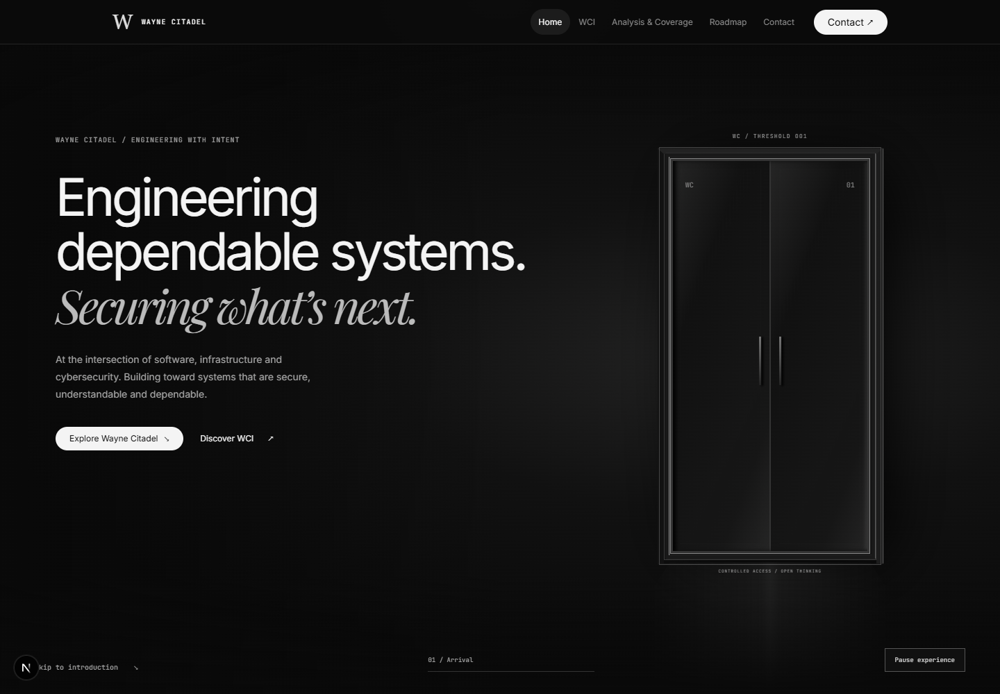
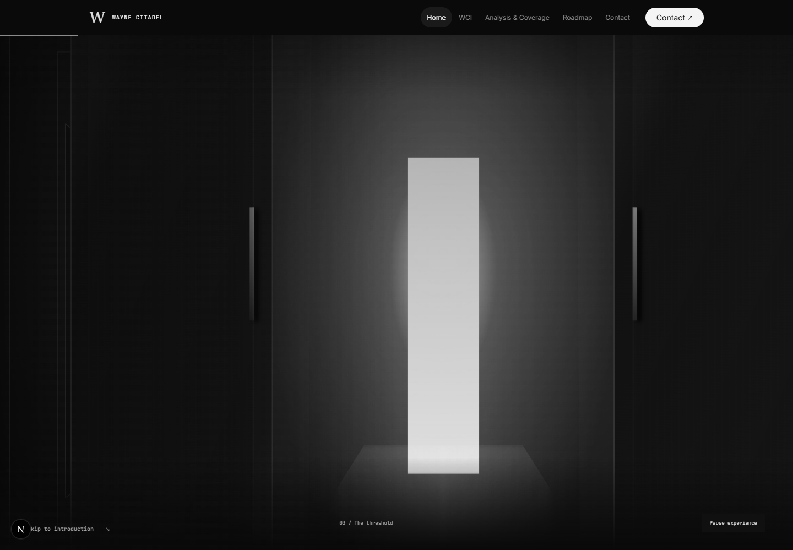
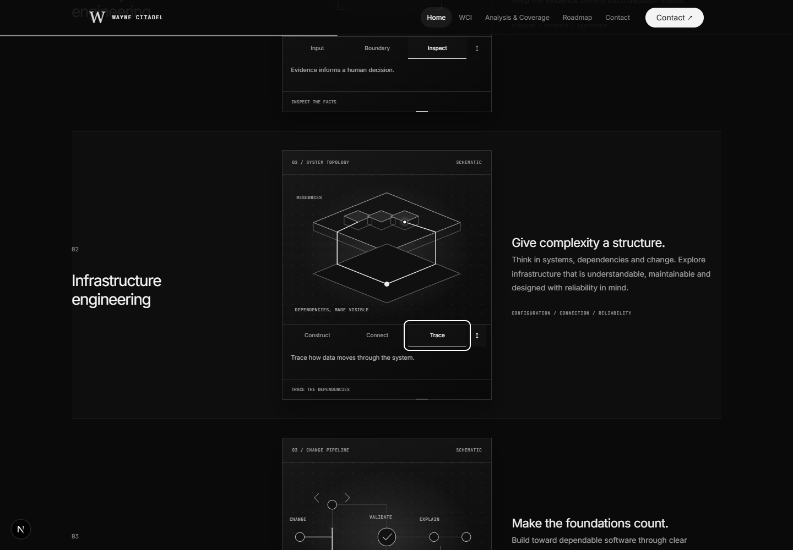
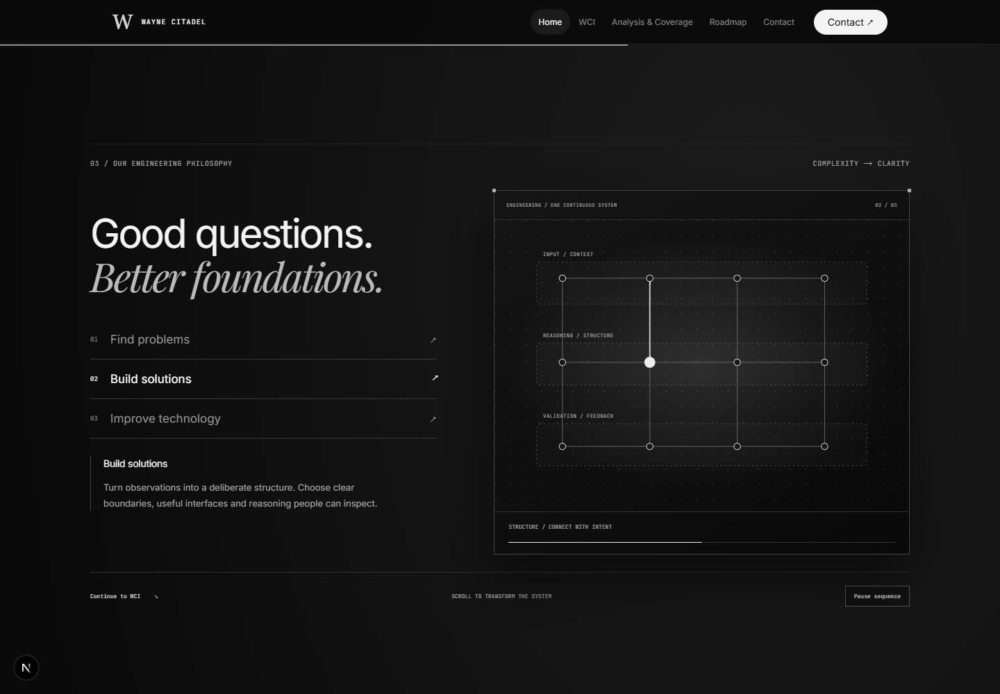
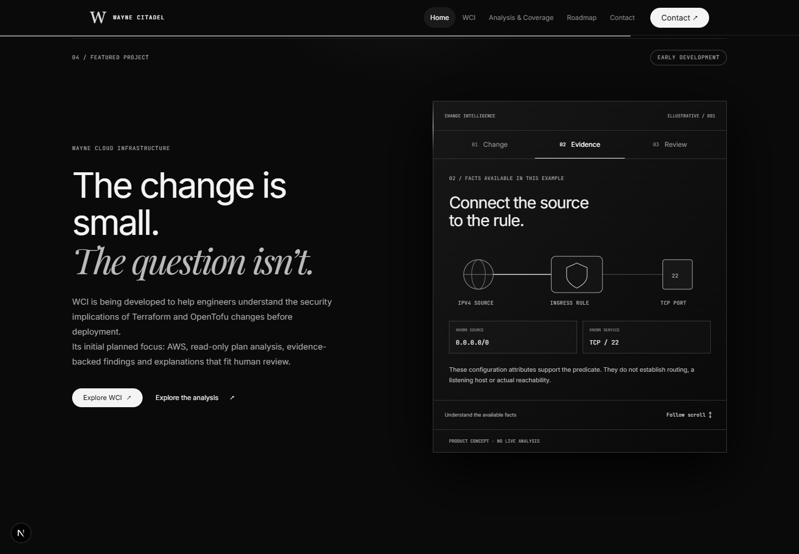
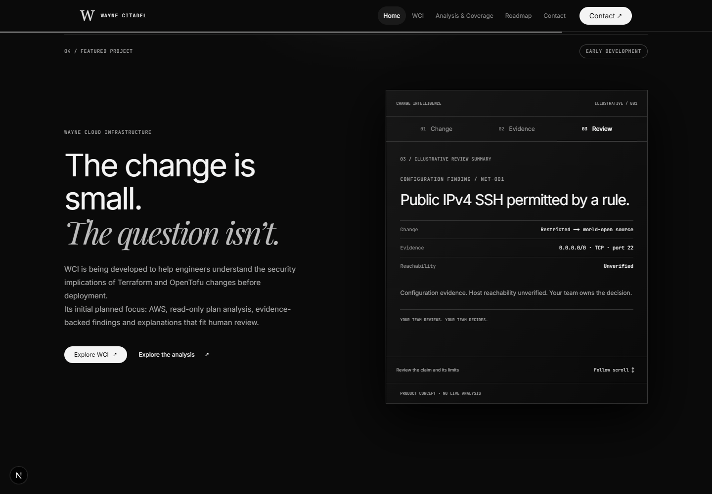
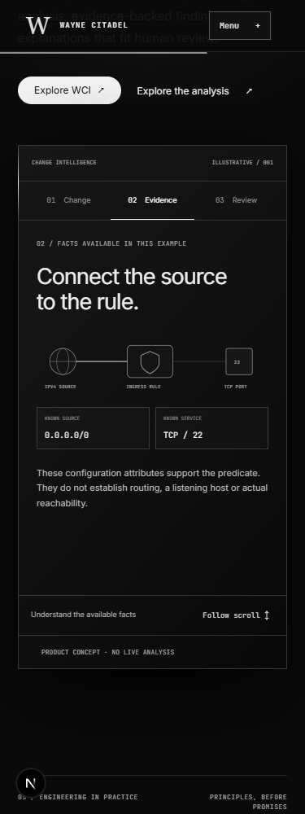

# Wayne Citadel homepage — review guide

20 November 2026. Submission authorized by the user. Branch: `feat/cinematic-homepage`; base: `main` (6f46b58 at preparation). No merge or production promotion is part of submission.

## Result

The root route now introduces Wayne Citadel instead of redirecting to Analysis. A native-scroll architectural portal opens into a corridor for Security, Infrastructure and Software. The page then introduces the company, engineering disciplines, an interactive/pinned philosophy, early-development WCI, practical principles, longer-term product direction and contact. The existing grayscale tokens, fonts, button styles and shared shell are retained.

The implementation uses original CSS perspective and SVG. One event-scheduled frame per scroll batch updates geometry, with IntersectionObserver suspension offscreen. No animation/rendering dependency was added. Home skips the existing Lenis interpolation so its camera follows native scroll; other routes retain Lenis.

Engineering diagrams have distinct security-boundary, isometric-resource/dependency and change-validation-review flows, with native stage controls for keyboard/touch, mouse hover and explicit Follow scroll behavior. The Philosophy stage transforms continuously while pinned on capable desktop viewports. WCI Change/Evidence/Review show different panels, retaining configuration evidence and unverified reachability. System reduced motion, mobile/short windows and no-JavaScript browsing have readable unpinned alternatives. Shared Home/WCI navigation and mobile Escape/focus behavior work; the company logo points to `/`. Footer reference placeholders have real destinations.

## Review images

These browser screenshots are committed for review. Private recordings, source videos, reference extractions and test output remain ignored.

## Frontend-only deployment mode

Set `NEXT_PUBLIC_FRONTEND_PREVIEW=true` at build time and `FRONTEND_PREVIEW=true` at runtime for review deployments. The Contact form retains its visual/field interactions but disables sending with a visible preview notice. The API returns an explicit 503 before loading database modules. Without preview mode, existing validation and storage behavior remain in place, with database modules imported when a real submission needs them. Database credentials are no longer required simply to compile the frontend. No database has been provisioned or submission storage tested.

`.vercelignore` excludes private artifacts, research, generated build output, environment files and review documents from deployment source uploads. The prior Vercel preview documents the 19 November version; the final precision pass has only been reviewed locally, so the older deployment is not an exact preview of this PR's final visuals. Do not publish the expiring access token in the PR.

## Validation and limits

- `npm ci` passed; no manifest or lockfile changes. No lint/test script is configured.
- Final `npx --no-install tsc --noEmit`, `npm run build` and Git diff whitespace checks passed before PR packaging. Source cleanup removes only two unreferenced earlier prototypes; the current components are unchanged.
- Edge/Playwright captures show portal phases and reverse scrolling, all diagram controls, three distinct WCI panels, manual-choice persistence and return to scroll following.
- Desktop/tablet/mobile (1440, 768 and 375px) checks passed in the final precision pass; the preceding full enhancement pass also covered 320, 390, 1024 and 1920px. No horizontal overflow was observed.
- The full enhancement run verified Philosophy forward/reverse/fast scrolling, reload restoration, pin release, pause, navigation, reduced motion, short viewport and no-JavaScript content. The precision pass added keyboard and touch stage-control checks and no-JavaScript Review readability on the final production build.
- All existing routes loaded; `/scope` intentionally redirects to `/roadmap`. Home has one header/footer. WCI's pre-existing nested header/footer remains outside this change's cleanup scope.
- Contact has an existing reduced-motion hydration warning from its Framer Motion initial attributes. It is documented; the teammate-owned Contact animation is preserved. Homepage checks captured no page JavaScript exceptions. This is not a full WCAG audit, Lighthouse result, physical-device performance profile or backend/database verification.

## Local review

Run `npm ci`, then set the two frontend-preview variables above and run `npm run dev`. Open http://localhost:3000/ . Scroll forward and backward through the portal, use all engineering controls, pause/skip the Philosophy sequence and inspect Change/Evidence/Review. Repeat with reduced motion and a phone viewport. Do not submit real contact data in preview mode.

The companion research, implementation, enhancement and precision reports retain detailed source observations and stage-specific validation history. Raw local screenshots/walkthroughs are in ignored `artifacts/`; only selected review PNGs are included here.
